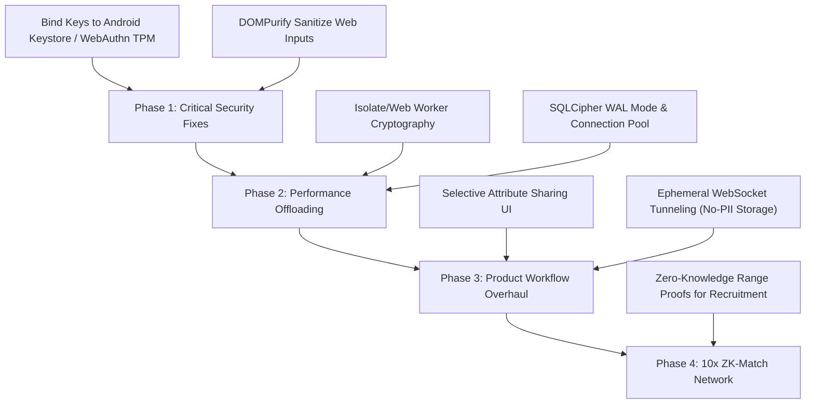

# OPIS: Executive Summary
**Omnimise Product Intelligence Suite**  
**Engineering Review Framework & Platform Audit**

---

## 1. Project Background
Omnimise is a decentralized, sovereign credential aggregator and trust verification platform. In an era where centralized databases represent massive honeypots for identity theft and AI-generated fraud is rising, Omnimise shifts data ownership to the edge. All credentials reside encrypted on the user's handset/browser, and cryptographic keys verify authenticity without central brokers.

This review framework (OPIS) assesses the current technical implementation of both the Android app and the Web portal, proposing structured improvements for backend architecture, security systems, and UI/UX design.

---

## 2. Core Technical Findings

### A. Security Vulnerabilities (High Severity)
* **Encryption Key Leakage**: SQLCipher (database encryption) is utilized, but the decryption password/keys are stored in plaintext localStorage (Web) and standard SharedPreferences (Android). If a device is rooted or compromised via XSS, the entire vault is exposed.
* **XSS in Portfolio Viewers**: Lack of strict HTML sanitization on rich-text inputs in the custom resume builder allows stored Cross-Site Scripting (XSS) execution.

### B. Performance Bottlenecks
* **Blocking Cryptographic Operations**: Heavy asymmetric key pair generation (Ed25519) and document signing run directly on the main UI threads. This causes interface freezes (jank) ranging from 300ms to 1.5s.
* **Database Locking**: SQLite connections lack Write-Ahead Logging (WAL) and pooling configurations, leading to `SQLITE_BUSY` errors when concurrent background processes write to the database.

---

## 3. Recommended Roadmap & Feature Evolution

---

## 4. Key Metrics for Success
* **Framerate stability**: 0ms main-thread blockage during key generation, maintaining 60fps/120fps client rendering.
* **Security integrity**: Zero key extraction possibility on unrooted devices (secured inside Secure Enclave/Keystore).
* **Verify latency**: Share negotiation and credential viewing times reduced from 3.8s server-dependent builds to <200ms ephemeral peer-to-peer data transfers.
